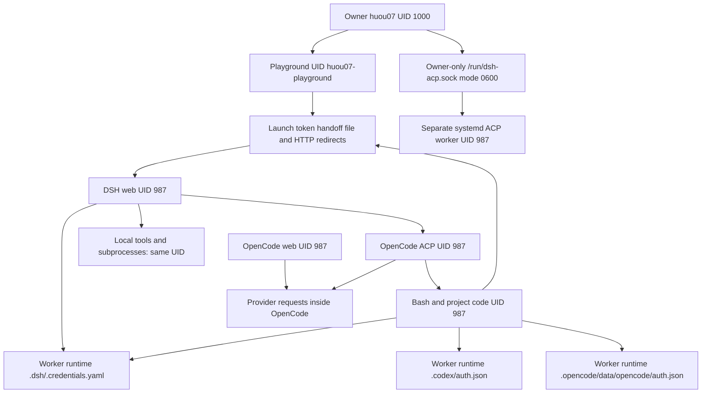

# DSH boundary repair — partial implementation, 15 October 2026

**The isolation objective is NOT achieved. Production credentials remain exposed to UID 987.**
No production service, credential, SSH setting, sudo policy, token directory permission, or ACP socket permission was changed. No root command was executed. The disabled legacy unit was not started. This is a tested containment candidate and reproducible staging work, not a completed migration.

## 1. Observed execution boundary



Observed services: `agent-workbench-dsh@3080.service`, `agent-workbench-opencode-web.service`, and `huou07-playground.service` are active. DSH process 106245 and its OpenCode ACP child 107311 were UID 987; launcher 106237 and OpenCode web 1112 were also UID 987. PIDs are a snapshot, not configuration constants.

The existing socket activation path is an execution boundary to a worker, but its owner-only socket is not accessible to `huou07-dsh`. Its worker is still credential-bearing when using the exposed runtime. It is not a model credential broker.

Source evidence from the installed DSH 0.2.0-rc.2 tree:

- `dsh-client-connection/lib/index.js:325–367`: BrowserAuth calls `credentials.modifyRecord` to initialize its persistent signing secret. Read-only credentials cannot satisfy startup.
- The same file, lines 388–407 and 586–591: a launch token mints a signed session cookie; admitted API requests speak for the operator. The token is an owner capability, not a harmless readiness URL. It remains redeemable during the process lifetime; the publisher's “one-time” description should not be interpreted as single use.
- `dsh-subprocess-local/lib/index.js:1356–1368` and `lib/runner-launch-B2zsQ1Dz.js:1020–1041`: ordinary subprocess launch provides cwd, environment, stdio and containment, but no different UID/GID. PTYs use local `node-pty` at index.js:1450.
- `dsh-credentials-local/lib/index.js:390–446`: the credential provider caches and updates managed references and records.
- `dsh-llm-deepseek-api-key/lib/index.js:42–50` and `dsh-llm-pi-ai/lib/index.js:2565–2569`: DSH resolves credentials before provider dispatch. The pi-ai adapter's records also hold OAuth grants and refresh state (around lines 1975–2027).
- Installed Codex ACP's `dist/index.js:27852–27859` spawns Codex app-server; authentication is delegated to that child. The exposed Codex auth file reports ChatGPT mode and stored tokens. No authenticated Codex turn was tested.
- A real installed OpenCode 1.18.35 turn against a mock provider requested Bash and executed it under the controller UID, both as 1000 and as 987. This proves the unsafe UID inheritance without using live provider credentials.

## 2. Root cause and additional paths

UID 987 owns the credential-bearing application processes and arbitrary project execution. File modes, cleaned child environments and systemd containment do not separate these principals.

The worker-side probe confirmed:

| Check as UID 987 | Observation |
|---|---|
| Open worker DSH credentials, without reading contents | Allowed |
| Open worker Codex auth, without reading contents | Allowed |
| Open launch-token file | Allowed |
| List launcher/DSH/OpenCode web/ACP FDs; open their `/proc/.../environ` | Allowed |
| Fetch dashboard DSH launch endpoint | Returns bearer token; response not redeemed |
| Connect to `/run/dsh-acp.sock` | Denied |
| Write root-owned wrappers and production dashboard source | Denied |
| Write `/srv/agent-workbench/skills` and `AGENTS.md` | Allowed |

Additional findings:

- The production LAN proxy also publishes the token automatically on `GET /`. Protecting only the dashboard API leaves this bypass.
- Default ACLs on `/home/huou07` grant worker read/traverse access to newly created paths, despite `umask 077`. A new dummy fixture was readable until explicit directory mode 0700 and file mode 0600 restricted the inherited ACL mask. No production home ACL was changed.
- Worker profile dependencies include `dshmarket`, `dsh-cost-meter`, and the ACP adapter. Its profile manifest and patch configuration are worker-owned. Moving these into a trusted process would import untrusted executable/configuration state.
- Worker-readable auth files were also found in `.opencode/data/opencode/auth.json`. The metadata inventory excluded `node_modules` and `.git`; it is not a complete historical backup/cache inventory.
- The legacy disabled unit starts a root launcher, has port/runtime collisions, and locally drops DSH to UID 992. Its launcher still starts local tools under the DSH identity. Enabling it would not repair the boundary.

## 3. Implemented minimal containment; full architecture unresolved

The immediate candidate authenticates both Playground token handoff paths with the existing owner Web login, rejects duplicate Authorization headers, and strips that login before forwarding LAN requests to the worker backend. It uses the existing `OPENCODE_PUBLIC_*` login, never the worker backend password. Missing configuration fails closed. It does not create, change or rotate any owner secret.

The repository launcher now reports sanitized publication failures, exits unsuccessfully, terminates/reaps its child, and removes temporary files. **The active server uses a different wrapper (`worker-web-v7`); that live wrapper has not been replaced by the repository launcher.** The candidate is not represented as a live publisher repair.

Rejected full-repair shortcuts: chmod-only changes break BrowserAuth; moving the entire service to UID 992 preserves same-UID tool access; exposing the existing owner ACP socket would weaken the established boundary; copying the worker profile would trust worker-controlled plugins/configuration.

A full design must separate both subprocess and filesystem execution, including ACP/MCP/custom plugins, from the trusted controller. DSH's replaceable subprocess service is a potential integration seam, not evidence that all execution paths are covered. No complete remote subprocess/filesystem adapter has been implemented or validated here.

A provider gateway is an alternative for worker-side OpenCode/Codex, but it does not solve trusted browser authentication by itself. It must authenticate callers, fix destinations/routes/models, impose request/token/concurrency budgets, reject arbitrary forwarding, and keep OAuth access/refresh handling in the trusted process. Existing LiteLLM/OmniRoute services have not been verified as satisfying these requirements; no new gateway daemon was added.

OpenAI's current [Codex app-server OAuth documentation](https://developers.openai.com/siwc/token-sharing-open-source/codex-app-server) describes access-token injection and renewal. Passing those tokens to a worker process would reproduce the exposure. Compatibility of the installed ACP/Codex version with a brokered OAuth path, including refresh and streaming, remains untested. No claim of a safe OAuth broker is made.

## 4. Exact changed and staged files

Repository changes:

- `web/app.py`: owner authentication before token access.
- `deploy/systemd/huou07-playground.service`: optional existing protected owner-login environment file.
- `deploy/dsh-dashboard-launcher.py`: visible, sanitized failure and child cleanup.
- `deploy/security/playground-owner-auth.patch`: patch against the actual production dashboard, including its additional LAN handoff path. It preserves the live proxy/VPN code absent from this checkout.
- `deploy/security/dsh-boundary-probe.py`: worker metadata-only probe.
- `deploy/security/stage-dsh-auth.py`: disposable DSH browser/restart tests.
- `deploy/security/stage-opencode-tools.py`: real tool turns against a mock model provider.
- `deploy/security/stage-dashboard-auth.py`: candidate handoff, header stripping, and rollback semantics tests.
- `deploy/security/owner-auth-preflight.py`: owner-run, read-only live-login gate.
- `deploy/security/90-dsh-token-quarantine.conf`: fail-closed rollback drop-in.
- `tests/test_app.py`, `tests/test_clean_install.py`, `tests/test_dsh_boundary.py`, `Makefile`, `README.md`, and these security notes/manifest.

The protected server staging directory is `/home/huou07/dsh-security-review-20261015` (explicit mode 0700, worker read/write denied). It contains the original and candidate dashboard source, patch, probes, tests, harmless private fixture, and sanitized unit/root-wrapper snapshots under `nonsecret-snapshots/`. No live credential files were copied. The staging scripts run under fresh temporary HOME directories, not the exposed production runtime.

## 5. Evidence and acceptance status

- `make check`: all 97 repository tests passed, including the new authentication, publication-failure, and probe/preflight checks. Syntax checks passed. No browser E2E suite was run.
- Fresh DSH on loopback port 13080: unauthenticated index/API rejected; real token exchange minted a working cookie; authenticated index contained HTML; forged cookie rejected; fresh private credential store created. Restart changed the launch token, rejected its predecessor, and retained the persisted signed session. All passed; UID was 1000, not the proposed trusted service UID 992.
- Real OpenCode mock-model turn as UID 987: tool UID 987, authorized disposable project edited/tested, worker-owned fixture openable, owner-protected dummy fixture denied. All passed. No live credentials or provider requests used.
- Production dashboard candidate with fixture logins/tokens: owner accepted, unauthenticated/worker/duplicate headers rejected on both handoff paths; forwarded request succeeded without the owner Authorization header. All twelve candidate/rollback checks passed.
- Rollback application semantics: original dashboard and LAN handoff return 503 without a readable token. This models the proposed systemd mask; the actual root/systemd rollback has not run.
- Production DSH, OpenCode Web and Playground remained active. VPN browser access, real provider/Codex inference, production restart, and a full UID-992 tool boundary remain **unverified**. Existing owner-only ACP permissions were preserved.
- Worker probe still fails the required production credential and token secrecy checks. This is expected evidence of the unfixed boundary, not an acceptance pass.

## 6. Exact owner-review commands — LIMITED token containment only

These are not full-isolation cutover commands. Review the patch and manifest first. An owner must execute any approved root operations; the agent has not invoked sudo. Expected Playground restart interruption: a few seconds, unmeasured. DSH/OpenCode are not restarted. If the read-only preflight fails, stop; do not create/change secrets as part of these commands.

On the Debian server as `huou07`:

```sh
python3 /home/huou07/dsh-security-review-20261015/stage-dashboard-auth.py
printf '%s  %s\n' 'd6c0e452a95fb354c21f4dce9dd0892c126a5482b5653415e7ea0dd938164993' /home/huou07/dsh-security-review-20261015/playground-owner-auth.patch | sha256sum -c -
printf '%s  %s\n' 'ea5f9dc4dc92b51e5efe954362ee54f06368611fdd8cb460c7706ac284a92d5d' /opt/huou07-playground/current/web/app.py | sha256sum -c -
sudo /usr/bin/python3 /home/huou07/dsh-security-review-20261015/owner-auth-preflight.py
patch --dry-run --fuzz=0 -p1 -d /opt/huou07-playground/current -i /home/huou07/dsh-security-review-20261015/playground-owner-auth.patch
sudo install -d -m 0700 /root/dsh-boundary-20261015
sudo cp -a /opt/huou07-playground/current/web/app.py /root/dsh-boundary-20261015/dashboard-before.py
sudo patch --fuzz=0 -p1 -d /opt/huou07-playground/current -i /home/huou07/dsh-security-review-20261015/playground-owner-auth.patch
sudo systemctl restart huou07-playground.service
systemctl is-active huou07-playground.service agent-workbench-dsh@3080.service agent-workbench-opencode-web.service
```

Run each command individually; stop on failure. Check the candidate SHA in `dashboard-manifest.json` after patching. Then run the worker probe again: `dashboard_returns_launch_token` must become false. The other production credential exposure checks will still fail and must not be waived. The owner must check VPN/LAN/localhost browser login, redirect, actual DSH session, and OpenCode functionality; a 302 alone is not acceptance.

**No full production cutover is ready for approval.** Trusted controller/worker execution adapters or a validated gateway plus protected controller still require implementation and integrated tests. Approval of this small patch must not be treated as approval to migrate credentials, change service UIDs, weaken sockets, or rotate keys.

## 7. Rollback without restoring token disclosure

For this limited patch, first quarantine the handoff directory from Playground, then restore its old source. Existing browser cookies may continue to work in DSH; new dashboard/LAN token handoffs intentionally return 503. General dashboard pages remain available. Keep the quarantine until an authenticated handoff replacement is verified.

```sh
sudo install -d -m 0755 /etc/systemd/system/huou07-playground.service.d
sudo install -o root -g root -m 0644 /home/huou07/dsh-security-review-20261015/90-dsh-token-quarantine.conf /etc/systemd/system/huou07-playground.service.d/90-dsh-token-quarantine.conf
sudo cp -a /root/dsh-boundary-20261015/dashboard-before.py /opt/huou07-playground/current/web/app.py
sudo systemctl daemon-reload
sudo systemctl restart huou07-playground.service
```

Do not restore the old source without the mask. Do not enable `huou07-dsh.service` as rollback. This procedure does not cure the already-existing worker-owned stores; it prevents the containment rollback from reintroducing HTTP token publication. Namespace enforcement and production restart require owner approval and remain untested.

## 8. Remaining work and rotation checklist

1. Implement and validate the complete tool/filesystem/provider boundary before moving any live secret. Audit project config, plugin resolution, hooks, MCP, PTYs, subagents and background processes; each must run worker-side or be a fixed, validated trusted operation.
2. Stage under the actual trusted/worker UIDs with separate ports, runtime and dummy credentials. Prove worker denial of files, `/proc`, FDs, control sockets and trusted code paths. Preserve the VPN relay/trusted-host settings and owner-only ACP socket.
3. Inventory actual provider IDs and historical credential copies without printing values. Known exposed locations include the worker runtime's DSH, Codex and OpenCode auth stores. Also inspect old runtime versions, logs, exports, histories, caches and backups before claiming closure. The present scan was not comprehensive.
4. After a successful, approved cutover, revoke the exposed ChatGPT/Codex OAuth session and reauthenticate under the trusted identity. Metadata-only enumeration identified DSH references **`OPENCODE_GO_API_KEY`** and **`NANOGPT_API_KEY`**, plus an API credential for OpenCode provider **`opencode-go`**. Revoke/replace those OpenCode Go and NanoGPT keys. The OpenCode entry may duplicate the DSH key; the owner must confirm that when revoking it. Also revoke any additional OAuth grants/API keys found in the historical inventory; DSH record payloads were not exhaustively enumerated. Reference/provider identifiers were reported without credential values.
5. Invalidate old DSH browser signing/session state and launch tokens in the new trusted runtime. Restrict/quarantine obsolete stores and backups, including old copies, before retiring services. Preserve user data; do not delete a runtime indiscriminately.
6. Repeat both negative and owner functional tests, including actual inference, project editing/testing, VPN/localhost browser login, restart and fail-closed rollback. Only then mark the boundary repaired.

No credential was rotated, printed, or copied into staging. The system must continue to be treated as exposed until these remaining items are complete.
